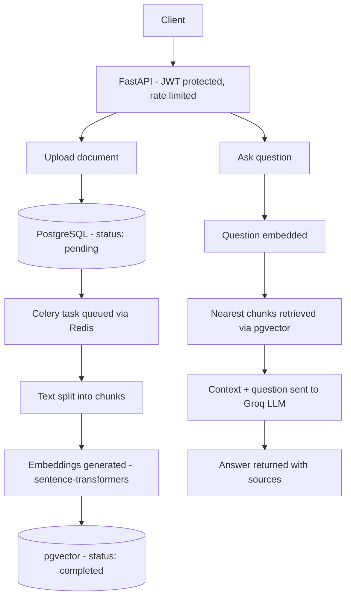

# AI Knowledge Base API

A Retrieval-Augmented Generation (RAG) API for building searchable, question-answerable knowledge bases. Users upload documents, the system automatically chunks and embeds them, and questions are answered by retrieving the most relevant chunks and passing them to an LLM as context.


## Features

- JWT-based authentication with access and refresh tokens, and secure password hashing (bcrypt)
- Document management with per-user access control (upload, list, view, delete)
- Asynchronous document processing (chunking + embedding) via Celery
- PDF upload with automatic OCR fallback: pages with a text layer are read directly, scanned pages go through Tesseract (per page, so mixed documents are handled efficiently)
- Image upload (screenshots) transcribed with a vision LLM
- Built-in RAG evaluation harness (Hit@k, MRR, abstention on out-of-scope questions, optional LLM-as-judge answer accuracy)
- `/health` endpoint checking PostgreSQL and Redis, wired into the Docker healthcheck
- Semantic vector search using PostgreSQL + pgvector
- RAG-based chat endpoint using Groq LLM, grounded strictly in uploaded documents, with source attribution
- Rate limiting on authentication and chat endpoints to prevent abuse
- Automated tests covering authentication, authorization, the RAG pipeline (LLM calls are mocked), PDF/OCR extraction, and the evaluation metrics
- Fully containerized: API, worker, PostgreSQL, and Redis run with a single `docker compose up`
- CI pipeline via GitHub Actions running the full test suite on every push

## Architecture



## Tech Stack

| Layer | Technology |
|---|---|
| API framework | FastAPI (async) |
| ORM | SQLAlchemy 2.0 (async) |
| Database | PostgreSQL + pgvector |
| Background tasks | Celery + Redis |
| Authentication | JWT (python-jose, access + refresh tokens) + bcrypt |
| Rate limiting | slowapi |
| Embeddings | sentence-transformers (all-MiniLM-L6-v2) |
| LLM | Groq (openai/gpt-oss-120b) |
| Migrations | Alembic |
| Testing | pytest, pytest-asyncio, httpx |
| Containerization | Docker, docker-compose |
| CI/CD | GitHub Actions |

## Running Locally with Docker

### Requirements
- Docker and Docker Compose
- A Groq API key (free at [console.groq.com](https://console.groq.com))

### Steps

1. Clone the repository:
```bash
git clone https://github.com/erbolboribaev/ai-knowledge-base-api.git
cd ai-knowledge-base-api
```

2. Create your environment file:
```bash
cp .env.example .env
```
Set `GROQ_API_KEY` and `SECRET_KEY` in `.env` to your own values.

3. Start the stack:
```bash
cd docker
docker compose up --build
```
This starts PostgreSQL (with pgvector), Redis, the API server, and the Celery worker, and applies database migrations automatically.

4. Open the interactive API docs:

http://localhost:8000/docs


## API Examples

### Register
```bash
curl -X POST http://localhost:8000/api/v1/auth/register \
  -H "Content-Type: application/json" \
  -d '{"email": "user@example.com", "password": "securepass123"}'
```

### Login
```bash
curl -X POST http://localhost:8000/api/v1/auth/login \
  -d "username=user@example.com&password=securepass123"
```
Returns both an `access_token` (short-lived) and a `refresh_token` (long-lived).

### Refresh access token
```bash
curl -X POST http://localhost:8000/api/v1/auth/refresh \
  -H "Content-Type: application/json" \
  -d '{"refresh_token": "<REFRESH_TOKEN>"}'
```

### Upload a document
```bash
curl -X POST http://localhost:8000/api/v1/documents/ \
  -H "Authorization: Bearer <TOKEN>" \
  -H "Content-Type: application/json" \
  -d '{"filename": "company_policy.txt", "content": "..."}'
```

### Upload a PDF (text or scanned)
```bash
curl -X POST "http://localhost:8000/api/v1/documents/from-pdf?ocr_lang=eng" \
  -H "Authorization: Bearer <TOKEN>" \
  -F "file=@contract.pdf"
```
Validates the file signature (not just the `Content-Type`), limits size (20 MB) and page count (100), and runs extraction in a worker thread so the event loop stays free. `ocr_lang` accepts Tesseract language codes such as `eng`, `rus` or `eng+rus`.

### Delete a document
```bash
curl -X DELETE http://localhost:8000/api/v1/documents/<DOCUMENT_ID> \
  -H "Authorization: Bearer <TOKEN>"
```

### Ask a question (RAG)
```bash
curl -X POST http://localhost:8000/api/v1/chat/ask \
  -H "Authorization: Bearer <TOKEN>" \
  -H "Content-Type: application/json" \
  -d '{"question": "What is the company policy about?"}'
```

## Evaluating RAG Quality

The `evaluation/` package measures how well retrieval and answering work on a small labeled dataset (`evaluation/dataset.json`: 6 documents, 14 answerable and 4 out-of-scope questions).

```bash
python -m evaluation.run_eval                 # retrieval only, no API key needed
python -m evaluation.run_eval --answers       # also generates answers and grades them with an LLM judge
python -m evaluation.run_eval --chunk-size 60 --top-k 3 --json-out evaluation/results.json
```

| Metric | Meaning |
|---|---|
| Hit@1 / Hit@k | The correct document is the top result / among the top k |
| MRR | Mean reciprocal rank of the correct document |
| Abstention rate | Out-of-scope questions for which nothing passes the similarity threshold, so the API answers "no information" instead of hallucinating |
| Answer accuracy | (`--answers`) LLM judge compares the generated answer with a reference answer |

Latest results (all-MiniLM-L6-v2, chunk size 500, top-k 3, openai/gpt-oss-120b via Groq, 18 labeled questions):

| Metric | Result |
|---|---|
| Hit@1 | 0.929 |
| Hit@3 | 1.000 |
| MRR | 0.964 |
| Answer accuracy (LLM judge) | 0.929 |
| Abstention on out-of-scope questions | 1.000 |

The set is small, so it is used to compare configurations rather than as an absolute quality claim.

Retrieval is computed in memory with the same chunker and embedding model as production, so the numbers reflect those settings; use the script to compare chunk sizes, `top_k`, thresholds, or embedding models before changing them.

## Rate Limits

| Endpoint | Limit |
|---|---|
| `POST /auth/register` | 5 per minute |
| `POST /auth/login` | 10 per minute |
| `POST /auth/refresh` | 20 per minute |
| `POST /chat/ask` | 20 per minute |

Limits are keyed by client IP address.

## Running Tests

```bash
pip install -r requirements.txt
pytest tests/ -v
```

Tests require a separate test database, configurable via the `TEST_DATABASE_URL` environment variable. Rate limiting is disabled automatically during test runs.

## Project Structure
```


app/
├── api/v1/ # Route handlers (auth, documents, chat)
├── core/ # Settings, security, rate limiting, logging
├── db/ # Database engine and session management
├── models/ # SQLAlchemy models
├── schemas/ # Pydantic request/response schemas
├── services/ # Business logic (RAG, embeddings, auth)
└── workers/ # Celery background tasks
evaluation/ # RAG evaluation dataset, metrics, and runner
tests/ # pytest test suite
alembic/ # Database migrations
docker/ # Dockerfile and docker-compose.yml
```

## License

MIT
